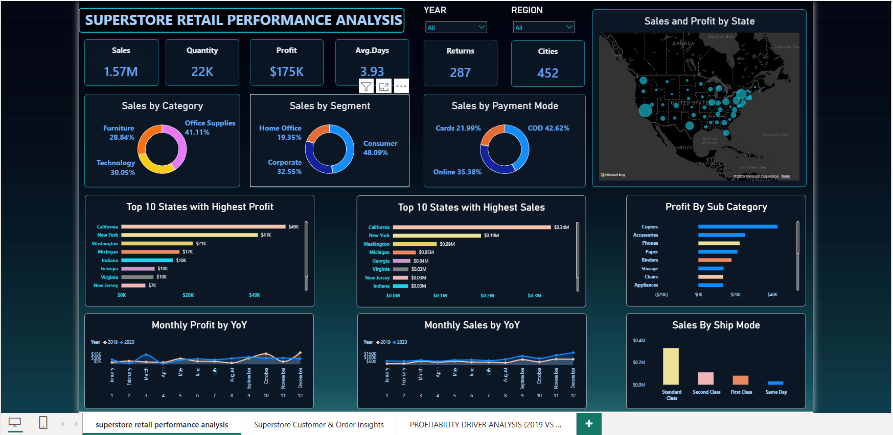
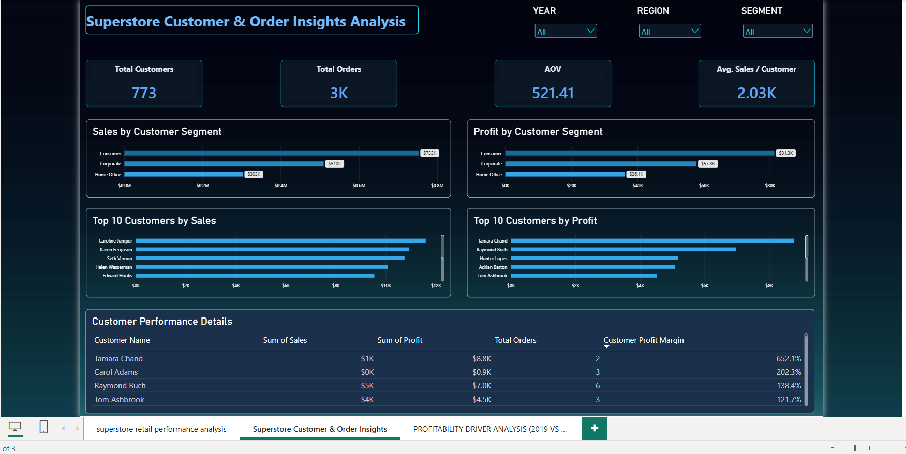
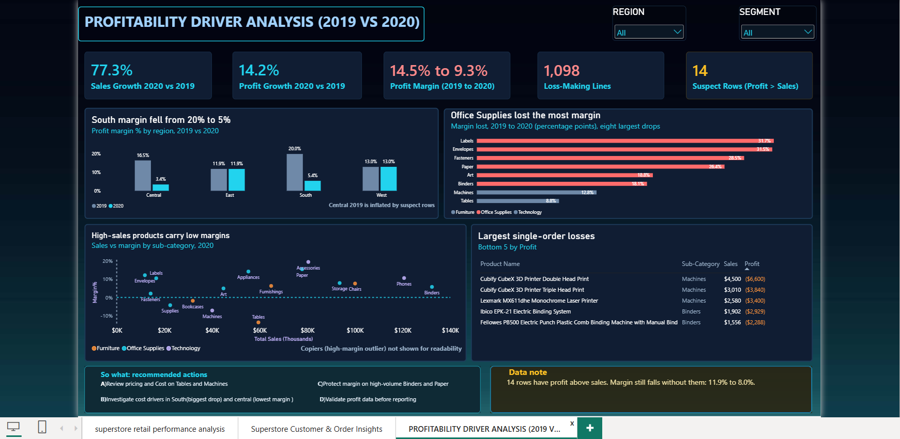

# Superstore Retail Sales & Profitability Analysis

> **Sales grew 77% in 2020, but profit grew only 14%.** This end-to-end project finds out where the margin went.

**Tools:** Excel · MySQL · Python (pandas, seaborn, SciPy) · Power BI

## Business problem
Superstore's sales almost doubled from 2019 to 2020, yet profit barely moved. The goal was to find *where* profitability eroded and which areas need attention.

## Key findings
| Metric | Result |
|---|---|
| Total sales (2019–2020) | $1.57M |
| Total profit | $175.3K |
| Overall profit margin | 11.19% |
| Sales growth 2020 vs 2019 | +77.3% |
| Profit growth 2020 vs 2019 | +14.2% |
| Profit margin | 14.5% → 9.3% |
| Loss-making order lines | 1,098 (≈ $91.7K lost) |

- **Office Supplies** lost the most margin (≈ 20% → 8%); Labels, Envelopes, Fasteners and Paper fell the most.
- **South** margin fell from ~20% to ~5%; **Central** has the lowest 2020 margin.
- **Tables** and **Machines** are loss-making sub-categories.
- 14 rows have profit greater than sales (data-quality flag). The margin decline still holds without them (11.9% → 8.0%).

## Dashboards




## Repository structure
```
├── data/       dataset notes (add superstore_cleaned.csv here)
├── excel/      workbook: cleaning, pivot summaries, KPI sheet
├── sql/        MySQL: data checks, KPIs, margin-erosion analysis
├── python/     EDA notebook + requirements.txt
├── powerbi/    .pbix dashboard (3 pages)
├── images/     dashboard screenshots
└── docs/       final presentation (PDF)
```

## How to reproduce
1. **Excel:** open `excel/SuperStore_Sales_Dataset.xlsx` (see `Cleaned_Data` and `KPI Summary`).
2. **SQL:** load the cleaned data into MySQL table `retail_analytics.superstore_staging`, then run `sql/superstore_retail_analysis.sql`.
3. **Python:** `pip install -r python/requirements.txt`, put `superstore_cleaned.csv` next to the notebook, run `python/retail_sales_eda.ipynb`.
4. **Power BI:** open `powerbi/superstore_project_analysis.pbix` in Power BI Desktop.

## Recommendations
- Track profit margin alongside sales growth.
- Review pricing and costs for Tables and Machines.
- Protect margin on high-volume Binders and Paper.
- Investigate cost drivers in South and Central.
- Validate unusual profit records before reporting.

## Limitations
The dataset has no discount, product cost, shipping expense or return-reason fields, so the analysis identifies *where* margin fell, not the underlying *causes*.

## Author
**Garv Wadhwa** — Data Analyst · [LinkedIn](https://www.linkedin.com/) · [GitHub](https://github.com/)
